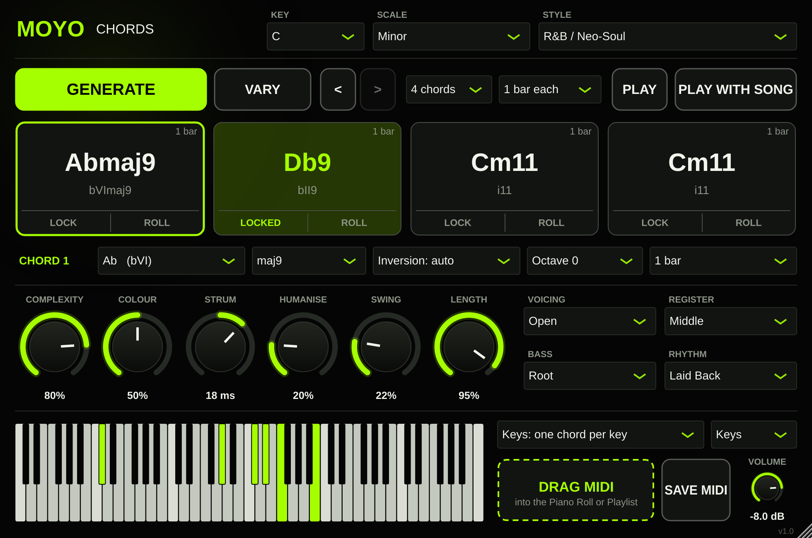

# MOYO Chords

A chord progression generator and player for FL Studio (VST3 on Windows and Mac, plus AU on Mac). It writes progressions in ten styles, voices them smoothly, plays them with a rhythm and feel, and hands them over as MIDI.



## What it does

| Area | Details |
|---|---|
| **Generate** | 142 hand-picked progressions across 10 styles (Hip-Hop / Boom Bap, Trap, R&B / Neo-Soul, Gospel, Pop, Lo-fi / Jazz, Afrobeats / Amapiano, House, Drill, Cinematic) and 10 scales, varied on every press. |
| **Shape** | COMPLEXITY goes from plain triads to 7ths, 9ths, 11ths and 13ths. COLOUR adds borrowed chords, secondary dominants, tritone substitutions, and sus / add9 / 6 flavours. |
| **Edit** | LOCK chords you like and regenerate the rest. ROLL one chord. VARY keeps the chords and changes their extensions. Undo and redo. Edit any chord by hand: root, type (30 chord types), inversion, octave, length. |
| **Voice** | Five voicing styles (Close, Open, Wide, Shell, Rootless). Each chord picks the inversion that moves least from the one before. Optional bass: root, root + 5th, or octaves. |
| **Perform** | 15 rhythm patterns including five arpeggios, plus STRUM, HUMANISE, SWING and note LENGTH. |
| **Play** | One chord per key, or every scale note plays its own chord, or the plugin plays along with the song. |
| **Export** | Drag the progression into the Piano Roll as MIDI, or save a MIDI file. The MIDI matches what you hear, note for note. |
| **Sound** | Built-in Keys, Pad and Pluck sounds so it works straight away. It also sends MIDI out to drive other instruments. |

See `INSTALL.txt` for install steps and a one-minute quick start.

## How it works

- `Source/MoyoTheory.h`: scales, 30 chord types, chord and Roman-numeral naming.
- `Source/MoyoGenerator.h`: the style progressions and the rules that vary them.
- `Source/MoyoVoicing.h`: voicing styles and voice leading.
- `Source/MoyoPerformance.h`: rhythm patterns, strum, swing, humanise. One note list feeds both playback and MIDI export.
- `Source/MoyoSynth.h`: the built-in sounds.
- `Source/PluginProcessor.*`: real-time MIDI handling. Every source of notes (keys, strums, song playback) files a request, the requests are sorted by time, and only then become MIDI, so overlapping sources cannot leave a note stuck.
- `Source/PluginEditor.*`: the window.

## Tests

```bash
cmake -B build -DCMAKE_BUILD_TYPE=Release -DMOYO_BUILD_TESTS=ON
cmake --build build --config Release
```

- **Engine tests** (`Tests/engine_tests.cpp`): theory, 4,000 generated progressions, voicing rules, every rhythm pattern.
- **Plugin tests** (`Tests/plugin_tests.cpp`): chord keys, strum timing, host sync against the exported MIDI, state save and restore, and a 4,000-step random stress test that checks for stuck notes.
- **Host test** (`Tests/host_test.cpp`): loads the finished `.vst3` the way a DAW does and checks MIDI in, MIDI out, sound and state.

GitHub Actions runs all three on Windows and Mac for every push, then publishes the zips to the **"MOYO Chords (latest build)"** release.

## Licence note

JUCE 8 is downloaded automatically at build time. JUCE's licence is free for personal use and for small businesses under its revenue limit. Check the JUCE licence before selling the plugin.
