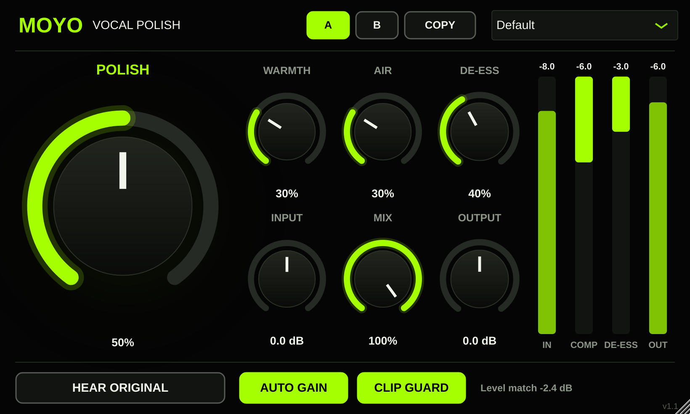

# MOYO Vocal Polish

A one-knob vocal chain, in lime and black, for FL Studio (VST3 on Windows and Mac, plus AU on Mac).



## What each control does

| Control | What it does |
|---|---|
| **POLISH** | The main knob. Raises the low cut (60–100 Hz), cuts boxiness at 300 Hz, adds compression (up to about 4:1), and adds presence at 3.2 kHz and sheen at 11 kHz. At 0% it does almost nothing. |
| **WARMTH** | Tape-style saturation plus body at 180 Hz. |
| **AIR** | Up to +7 dB high shelf at 11 kHz. |
| **DE-ESS** | Turns down harsh "s" and "t" sounds (detects around 7 kHz, ducks everything above 4.5 kHz). |
| **INPUT** | ±24 dB level going in. More input makes the compressor work harder. |
| **MIX** | Blends the dry and processed vocal. Under 100% gives parallel compression. |
| **OUTPUT** | ±12 dB final level. |

### Comparing

| Button | What it does |
|---|---|
| **HEAR ORIGINAL** | Switches to your untouched vocal at the same level (turns red while on). A 20 ms crossfade means no clicks. Automatable. |
| **A / B** | Two settings slots. Click B and it starts as a copy of A. Change it, then flip between A and B to choose. Both are saved with your project. |
| **COPY** | Copies the slot you're on into the other one. |
| **AUTO GAIN** | On by default. Matches output loudness to input loudness (about a 400 ms window, held through silence) so louder never tricks your ears. The readout shows how much it's adjusting. |
| **CLIP GUARD** | On by default. Leaves everything below -1 dBFS alone and rounds off peaks so the output never passes 0 dBFS. |

The meters show input level, compression gain reduction, de-esser gain reduction and output level, each with a dB readout.

## Presets

Default · Rap Lead · Smooth R&B · Bright Pop · Voiceover / YouTube · Gentle Touch · Parallel Crush

## Signal chain (runs at 2× oversampling)

Input → low cut → mud cut → warmth shelf → compressor (stereo-linked, soft knee, auto makeup) → saturation → de-esser → presence → air → mix → auto gain → output → clip guard.

Latency is reported to the host, so FL Studio compensates for it automatically. The dry signal used by MIX is delayed to match, so there is no phasing at any setting.

## Getting the plugin

Every push that changes this folder builds Windows and Mac versions on GitHub Actions. The zips go to the **"MOYO Vocal Polish (latest build)"** release in this repo. See `INSTALL.txt` for install steps.

## Building it yourself

```bash
cd plugins/moyo-vocal-polish
cmake -B build -DCMAKE_BUILD_TYPE=Release
cmake --build build --config Release
```

JUCE 8 is downloaded automatically. JUCE's licence is free for personal use and for small businesses under its revenue limit. Check the JUCE licence before selling the plugin.
